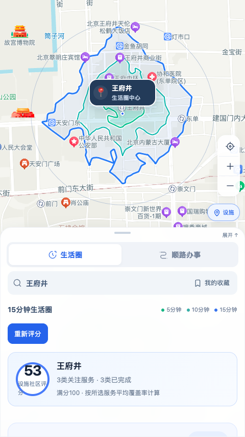
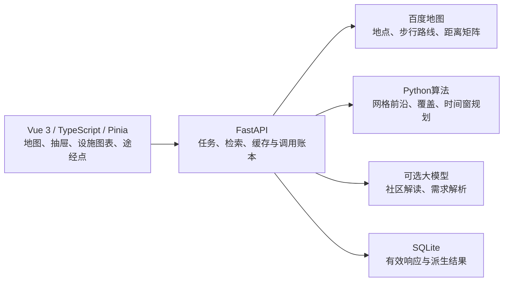

# 顺路 · 15分钟生活助手

家门口有什么，步行能到哪，路上还能办什么。

顺路是一款以地图为中心、优先适配手机的 Web 应用。它用真实步行测时生成生活圈，分析关注服务的覆盖情况，再把买药、买菜、取快递等日常任务放进一条可编辑的路线。

[项目介绍 PDF](docs/media/shunlu-introduction.pdf) · [安装与部署](docs/deployment.md) · [算法研究](docs/research/README.md) · [文档导航](docs/README.md) · [参与开发](CONTRIBUTING.md)

## 能做什么

| 场景 | 使用方式 |
| --- | --- |
| 看附近生活是否方便 | 搜索、地图选点或选择收藏地点，自动生成5、10、15分钟步行范围 |
| 了解社区服务 | 从29项服务中选择关注项，查看设施位置、覆盖图表和设施社区评分 |
| 比较改善方案 | 查看未覆盖位置与候选新增点，试放模拟设施并比较覆盖变化，导出报告 |
| 顺路办几件事 | 自由设置起终点，按实际绕行时间寻找沿途地点，添加途经点、调整顺序和停留时间 |
| 用一句话安排 | 输入办事内容和可用时间，推荐结果同步到原有途经点，之后仍可手动修改 |
| 接着用常去地点 | 生活圈与顺路共用地点收藏；顺路还支持路线收藏和反向重新规划 |

社区解读基于本次设施统计生成短文；路线助手理解任务、时间与先后关系。地点、路径耗时和计划是否可行，仍由地图数据及规划算法决定。AI是可选能力，未配置时可以继续手动使用核心功能。



### 怎样理解结果

生活圈是有限测点重建的近似范围，河流、出入口和狭窄道路附近仍可能有误差。绿色、青色、蓝色分别表示5、10、15分钟；设施分析固定使用15分钟范围。

每类设施覆盖率表示：本次圈内采样点中，能在15分钟内走到至少一家参评设施的比例。每类最多取5家参评设施，社区分数是所选服务覆盖率的算术平均，**不是人口覆盖率或国家达标评分**。检索结果也不等于现实中的全部设施；查询失败、未测完整和未检索到设施需要分别理解。

沿途生活圈固定15分钟，只展示已完成中心的分析范围。位于圈内不等于一定顺路，门店选择还要看有方向的绕行时间、停留和到达限制。

## 本地运行

需要 Python 3.12、Node.js 22.12+、npm 和 make。产品依赖通过 Python 锁文件和 `web/package-lock.json` 安装。

```bash
git clone https://github.com/hyh32767-cpu/15min_life_cycle.git
cd 15min_life_cycle
make setup
cp .env.example .env
# 在 .env 中填写百度服务端 AK 和独立的浏览器端 AK
make demo
```

打开 <http://127.0.0.1:18080>。`make demo` 构建前端，再用同一个服务提供界面和API。生活圈位于 `/community`，顺路办事位于 `/`，API说明位于 `/docs`。

日常开发用两个终端：

```bash
make api-run   # 后端 http://127.0.0.1:18080
make web-dev   # 前端 http://127.0.0.1:5173，代理 /api 到后端
```

也可以运行 `./start_dev.sh` 同时启动两端。后端换端口时，前端也需使用相同的 `API_PORT`，例如分别运行 `make api-run API_PORT=18081` 和 `API_PORT=18081 make web-dev`。

### 配置

所有示例中的密钥均留空，不含可用凭据。复制 [.env.example](.env.example) 后，在自己的本地文件或服务器环境文件中填写；不要把实际值放入README、截图、问题反馈或版本库。进程环境变量优先于项目根目录 `.env`，修改后需要重启后端。

| 变量 | 用途 |
| --- | --- |
| `BAIDU_MAP_AK` | 服务端地图访问密钥，必填，只在后端使用 |
| `BAIDU_MAP_SK` | 可选的签名密钥，不能替代AK |
| `VITE_BAIDU_MAP_AK_BROWSER` | 独立浏览器类型AK，为实际访问地址配置Referer白名单 |
| `BAIDU_TIMEOUT_S` | 地图请求超时，默认10秒 |
| `BAIDU_HTTP_TRANSPORT` | 默认 `system` 使用系统代理；`direct` 让后端百度业务请求直连，保持TLS校验 |
| `BAIDU_MAX_QPS` / `BAIDU_INTERFACE_QPS` | 全局与分接口请求节奏 |
| `BAIDU_MATRIX_PAIRS_PER_SECOND` | 矩阵按OD路线对数限速，默认3；不是HTTP请求数 |
| `BAIDU_MATRIX_ROUTES_PER_WINDOW` / `BAIDU_MATRIX_WINDOW_SECONDS` | 可选的批量窗口设置，按自己账号权限调整 |
| `LEDGER_DB` / `CACHE_DB` / `DERIVED_DB` | 默认写入本地 `api/var/` 的账本、响应缓存与派生缓存 |
| `SHUNLU_LLM_API_KEY` / `SHUNLU_LLM_MODEL` | 可选OpenCode Go访问密钥与模型；当前默认 `deepseek-v4.1-flash` |
| `SHUNSHOU_SERVE_WEB` | 设为 `1` 时由后端提供已构建前端；`make demo`和部署服务已设置 |
| `DATA_DIR` | 历史案例目录，默认 `demo-data/v1` |
| `API_PORT` | 启动命令与Vite代理端口，默认18080；换端口需同时传给两端命令 |

**百度配置**：创建独立的服务端AK与浏览器AK。服务端用于地点、步行路线和距离矩阵，按账号可用权限及额度配置；浏览器AK只用于JS API底图，需要将本地访问地址或正式域名加入对应Referer白名单。只有采用SN校验的服务端AK才填写SK；SK不能代替AK。浏览器AK会经 `/api/maps/config` 提供给浏览器，因此必须与仅保存在后端的服务端AK/SK分开。

**大模型配置**：在 `SHUNLU_LLM_API_KEY` 填写自己的OpenCode Go访问密钥，模型由 `SHUNLU_LLM_MODEL` 指定。当前实现连接固定的 `https://opencode.ai/zen/go/v1/chat/completions`，不是填任意厂商密钥即可切换的通用接口，也没有可用的Base URL环境变量。更换提供方需要修改后端适配。社区解读与路线解析仅在点击时调用，超时或缺少模型配置不影响手动规划与设施评分。

本地开发可复用已有OpenCode Go登录；生产运行设置 `SHUNSHOU_SERVE_WEB=1` 后不读取个人登录文件，须显式提供模型环境变量。不要将模型密钥设为任何 `VITE_*` 变量，否则可能进入前端构建。详细实现见[社区解读与路线安排](docs/81-社区解读与智能路线安排.md)。

默认配置采用保守限速。研究中的“单批50对”不等于50 QPS，也不代表所有账号都具有相同权益。完整配置项见 [.env.example](.env.example)。

## 服务器部署

推荐将前端构建后与API一起运行，由Nginx提供HTTPS入口，后端仅监听 `127.0.0.1:18080`。不需要在服务器运行Vite开发服务。

1. 本机运行 `make web-build`，再运行 `.venv/bin/python -m tools.deploy.tencent.build_runtime` 生成允许目录组成的运行包。
2. 上传运行包到服务器，安装Python运行依赖，配置独立服务账号和持久数据目录。
3. 在服务器 `/etc/shunshou.env` 填写百度与可选大模型密钥，权限设为 `600`；不要把本机 `.env` 或个人Go登录打包上传。
4. 使用systemd启动应用，配置Nginx、受信任HTTPS证书和云防火墙80/443端口；地图浏览器AK白名单加入正式访问地址。
5. 检查 `/api/health`、首页和 `/community`，再按需进行一次真实业务查询。健康检查不代表外部接口和额度已全部验证。

完整的首次部署命令、HTTP/HTTPS配置、更新回退和故障排查见 [安装与部署指南](docs/deployment.md)。目录中的旧服务器配置记录保留原部署值，新部署使用 [通用模板](tools/deploy/tencent/README.md) 替换为自己的域名和证书路径。

## 技术架构



百度JS API提供底图和地图交互，业务查询统一经过后端。地点、距离、路径和已返回营业时间采用真实API或未过期缓存；停留时间、假设服务点和临时事件明确区分。未知营业时间不视作全天营业，接口失败也不会生成替代路线。

### 当前等时圈算法

当前产品使用 `grid-frontier-barrier-v4`，核心在 [core/grid_frontier.py](core/grid_frontier.py)：

1. 在圆形区域布置100米网格，15分钟圈的测量半径上限为1.1公里，最多376个外部位置。
2. 主阶段由外向内逐层测量，同层完成后再推进；可达点停止该分支向内深入，减少不必要查询。
3. 主边界后检查贯穿轴线和内部抽检点，沿已知超时或断路点追踪内部屏障。
4. 每批发布进度。加载中轮廓从参考圆连续变化，完成后使用实测点的Delaunay时间场描线。
5. 绘图拟合与局部圆角只影响显示，设施过滤、覆盖和面积使用独立分析多边形，保留孔洞与分离区域。

5、10分钟层分别测量并复用有效OD，不由15分钟圈等比例缩放。未测内部仍包含估计；`complete`表示当前策略完成，不表示全域逐点证明。预算不足、触及测量范围和缺测状态保留在结果中。

[算法原理、演进与证据](docs/research/README.md)汇总了早期扇形、网格实验、兰州河流反例和新点测速，区分离线研究、实测时间及当前产品能力。

## 仓库导航

| 目录 | 内容 |
| --- | --- |
| [web/](web/) | 手机优先界面、地图适配、状态与领域函数 |
| [api/](api/) | FastAPI接口、地图网关、异步任务、缓存、账本与测试 |
| [core/](core/) | 等时圈、坐标、限流、覆盖辅助及路线规划内核 |
| [experiments/](experiments/README.md) | 历史研究脚本、结果与研究数据说明 |
| [tools/](tools/README.md) | 离线分析、真实测速、演示制作和部署工具导航 |
| [docs/](docs/README.md) | 当前技术说明、研究导航与按编号保留的历史记录 |
| [demo-data/v1/cases/](demo-data/v1/cases/) | 前端可展示的历史研究摘要，和当前实时结果分开 |
| `output/` | 本地生成的视频、地图和实验报告，默认不纳入源码 |
| `cache/`、`experiments/logs/` | 按项目维护者要求保留的研究数据库及缓存，提交前清除凭据 |
| `api/var/` | 本机正在使用的运行数据，不直接跟踪；静态快照见 `data/snapshots/` |

当前介绍PDF与精选界面图在 [docs/media/](docs/media/README.md)。新版实操视频及字幕保存在本地 `output/demo-video-20261016/`，制作过程见[演示记录](docs/82-顺路新版演示与项目介绍.md)。

## 检查与研究复现

仓库已有GitHub Actions，push和PR会运行后端与前端检查，无需配置百度或大模型Secrets。首次启用、权限及查看日志见 [Actions设置](docs/ci.md)。当前工作流不自动部署服务器。

```bash
make api-test    # 禁止外网的后端单测与接口测试
make web-check   # 前端类型、格式和单测
make web-build   # 前端生产构建
make web-e2e     # 使用模拟业务接口的浏览器测试
make check      # 上述检查与算法预检、发布扫描
```

测试中的模拟接口只用于检查程序行为，不作为产品实时数据。算法最小离线回归可运行：

```bash
.venv/bin/python -m pytest api/tests/unit/test_grid_frontier.py -q
```

实验脚本并非都能离线运行；部分还需要历史数据库、额外科学计算依赖或本机字体。先查看[工具导航](tools/README.md)和[研究复现说明](docs/research/README.md)，不要把整批 `run_*.py` 当作测试入口运行。真实地图与模型测试会消耗额度，默认检查不执行这些调用。

## 当前仍需改进

100米采样可能漏掉窄通道和局部障碍；有限POI检索不能替代实地调查。新旧算法的少量测速受API延迟、窗口和搜索范围影响，尚无同域全量参考下的普遍精度、速度排名。

最近一次实录中，沿途范围完成2/3处，另一处保留未完成提示；地图选点的自动化点击未触发选中，原因仍待独立排查。路线收藏还未持久化AI新增的时限字段。具体进度见 [TODO](TODO.md)，避免将历史测试通过记录理解为当前全部功能都已完成。

## 许可与贡献

原创代码采用 [MIT](LICENSE)。地图瓦片、POI、路线响应、赛事文件及第三方依赖遵循各自权利和服务条款，见[第三方说明](THIRD_PARTY_NOTICES.md)。

贡献前请阅读 [CONTRIBUTING](CONTRIBUTING.md)。仓库按维护者要求保留清除凭据后的数据库和缓存，应用运行包仍不携带这些数据；地图数据并不因此获得MIT再许可。已有Git历史中的敏感内容需单独处理，详见 [SECURITY](SECURITY.md)。
