# 00 · 答辩讲稿:十五分钟生活圈实验全流程(图解版)

> **这份文档怎么用**:按"幕"组织的讲故事稿,每幕 = 通俗讲法 + 图 + 关键数字 + 一句话结论。
> **不要写死**:新实验做完,在对应幕末尾的"〔待补〕"槽位加一段即可;新问题按"问题卡模板"复制填空。
> 图片全部相对路径引用 `../experiments/results/maps/`,新增图放同目录改一行即可。
> 配套:总集数据看 `experiments/notebooks/实验总集.ipynb`;单城现场演示看 `从零开始-单城全流程演示.ipynb`。

## 目录

- 第一幕 · 我们要回答什么(设计之初)
- 第二幕 · 先造可信的尺子(仪器标定 E0-E3)
- 第三幕 · 采样方法大比武(E4 杀手表)
- 第四幕 · 把散点变成地图(插值与绕行 E5E6)
- 第五幕 · 墙、河与铁路(极端边界与防线 E10)
- 第六幕 · 十六座城市的考验(规模梯度验证)
- 第七幕 · 优化之路:六张问题卡(针、口袋、小角度……)
- 第八幕 · 事故复盘:我们踩过的坑(工程教训)
- 第九幕 · 从体检到处方再到一键管线(E7-E10·E8)
- 第十幕 · 成本账本与性价比
- 附录 A · 图索引|B · 数字速查|C · 答辩 Q&A 预案

---

## 第一幕 · 我们要回答什么(设计之初)

**通俗版**:给一个社区地址,我们要在 15 分钟步行可达的范围内做"体检"——医院、学校、
菜场、药店、养老设施够不够?缺在哪?补在哪里收益最大?三件事决定成败:
**准**(等时圈画对)、**省**(API 配额有限)、**稳**(任何一层失效都能降级兜底)。

最初的设计(2026-08-24,`docs/11`):9 个实验、三个问题——

1. **仪器可信吗**(E0-E2:AK/签名/坐标系/批量测距)
2. **怎么采样最省最准**(E4:七种方法同场比武)
3. **边界画对了吗**(E10:墙/河/铁路的幻影边界)

配额思维从第一天就定下:**每一次调用进台账(calls.db)、进缓存(cache.db),
重跑零成本**——后面所有"二跑零调用"都源于此。

> 〔待补槽位:新增设计目标〕

---

## 第二幕 · 先造可信的尺子(E0-E3)

**通俗版**:尺子不准,后面全白干。我们先花一天把百度 API 的脾气摸透。

- **签名踩坑**:SN 校验的 safe 字符表差一个逗号,全站 211 报错——逐字符试探破解
- **坐标三系**:百度 BD-09 / 国测 GCJ-02 / GPS WGS-84(OSM、H3 用),转换链写进 `core/coord.py`,
  后续经纬度顺序bug累计踩了 5 次,教训单列第八幕
- **批量红利**:routematrix 一请求 50 对,**3885 次请求最终承载了 16,965 对**
- **并发测绘**(E3,配额恢复后补):2/4/8/16 QPS 全 40/40 零限流,P50 恒 1.66s

| 档位 | 成功 | P50 | P95 |
| --: | --: | --: | --: |
| 2/4/8/16 QPS × 40 | 全 40/40 | 1661-1715ms | 1748-2173ms |

**一句话**:限速取 10 QPS 匀速 + 401/302 退避;想快用批量,不要提并发。

> 〔待补槽位:E11 邻近点缓存、E12 起步路由将补充到本幕〕

---

## 第三幕 · 采样方法大比武(E4 杀手表)

**通俗版**:同一个社区,七种画圈方法打擂台——粗网格/细网格/16 射线/32 射线/自适应扇形/H3 六边形。
裁判是独立的留出评估点。

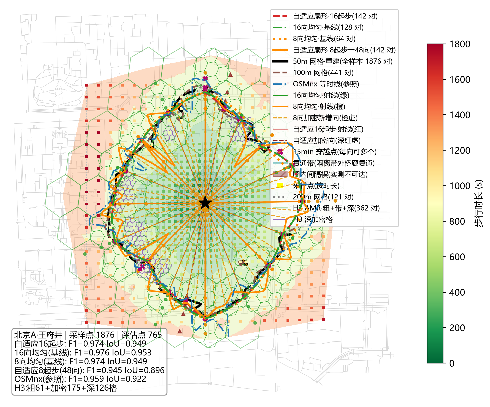

**杀手结论**(三轮口径修正后):**射线 112 对 + 多边形判定 ≈ 网格 441 对**,
而调用量只有四分之一。中途还修正过一次自己的评估方法(IDW 插值在凹口震荡→
改多边形分类→最终 Delaunay)——**裁判本身也会错,改判要留痕**。

**8 向还是 16 向?** 借"轨迹前缀性"(tol50 的探测序列是 tol15 的子集),
8/16 向都能从缓存零成本重放对比:**十城 F1 差 ≤0.013,判据不在指标在探针**——
见第五幕的"照妖镜"。

**成本终局结论(2026-09-01 修正)**:二十社区阶梯口径下,8 向+加密与 16 向均匀的
**对数几乎相同(19/20 城 0% 差,合计 -14% 因长沙错位返工)**——"8 起步省钱"只在
成品未超收敛时近似成立;真正的省钱手段是**测前路由**(DEM std≥5.3 → 直接 16 起步,
免返工轮)。用户双圈图实证驱动(4 个超收敛城曾让 8 向+低估自检成本爆炸,
根因与修复见 docs/13 七节、事故表 8 号)。

> 〔待补槽位:新采样方法加入比武〕

---

## 第四幕 · 把散点变成地图(E5E6)

**通俗版**:采样点是一把米,要摊成一张饼。比了 IDW/多边形分类/Delaunay 三种摊法:
**Delaunay 线性插值胜出**——它就是地图上那条黑色"50m 网格·重建"线的来源。

绕行系数 ρ(实际步行时长 / 直线时长@4.2km/h)同场标定,十五城中位:

| 城 | ρ 中位 | 城 | ρ 中位 |
|---|--:|---|--:|
| 长沙 | 1.29 | 洛阳 | 1.73 |
| 广州 | 1.38 | 义乌 | 1.98 |
| 哈尔滨 | 1.44 | 遵义 | 2.94(最高)|
| 上海 | 1.47 | 昆山 | 1.88 |

ρ 的三重身份:降级兜底系数 / 难度预测信号 / 障碍走廊图(第七幕第六卡详述其重新定位)。

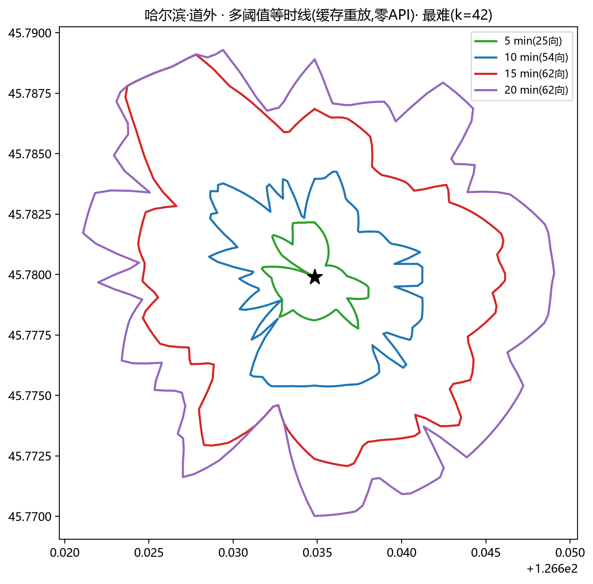
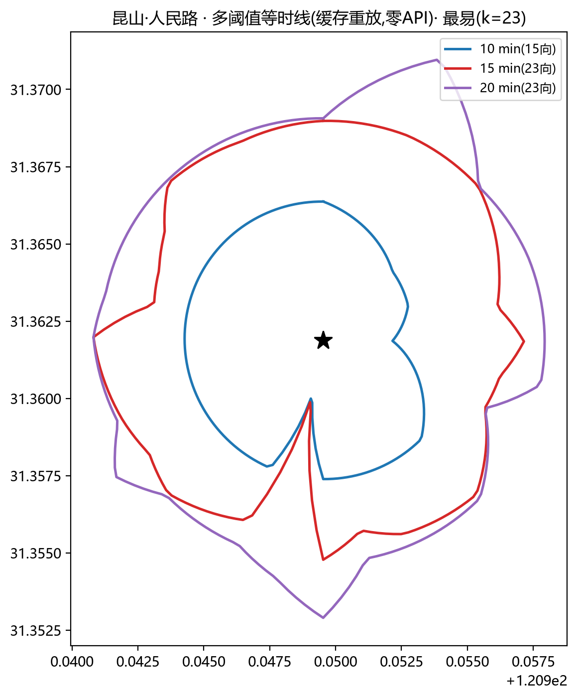

同一份缓存可以重放 5/10/15/20 分钟任意阈值——方法不绑定"15 分钟"这个数字。

> 〔待补槽位:其他插值方法〕

---

## 第五幕 · 墙、河与铁路(E10 极端边界)

**通俗版**:15 分钟边界经常撞上"过不去的东西"——一堵墙、一条江、一段铁路。
直线上 300 米,绕行 20 分钟。这类地方最容易画出**幻影边界**(看着可达其实过不去)。

**三道防线**(全部"证据驱动,命中才付费"):

1. **mid 探针**:每条弦的中点 0.97r 处实测,超时=弦外凸(凹口被盖住)→ 插向重二分
2. **ρ 探针**:弦两端点实际/直线比过高 = 这一带有障碍走廊
3. **孤岛抽检**:圈内随机点终审,抓"圈内不可达"的口袋

**照妖镜发现**:哈尔滨 8 向 F1(0.971)**反而高于** 47 向成品(0.957)——
**F1 会说谎**(粗评估点看不见窄条幻影),收敛判据必须是 mid 违规数。
这句话后来被反复验证:四城违规清零后 IoU 一字不变。

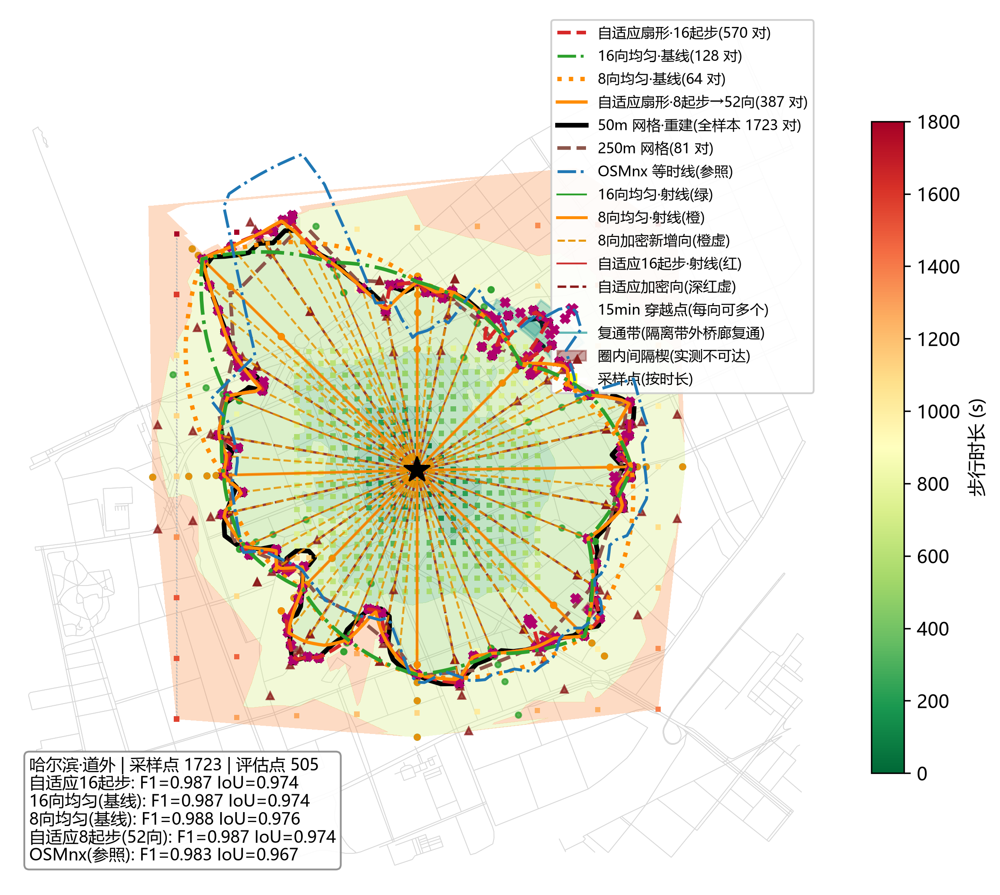

> 〔待补槽位:新防线〕

---

## 第六幕 · 十六座城市的考验(规模梯度)

**通俗版**:方法不能只在北上广深好使。十座大城市中心 + 五座中小城市(洛阳/昆山/桂林/遵义/义乌)
+ 一座现场演示城(南昌),梯度拉满。

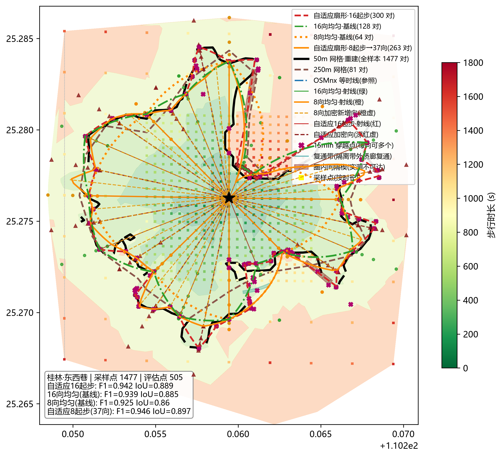
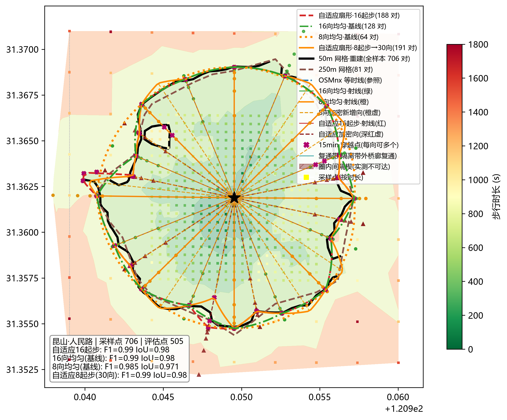
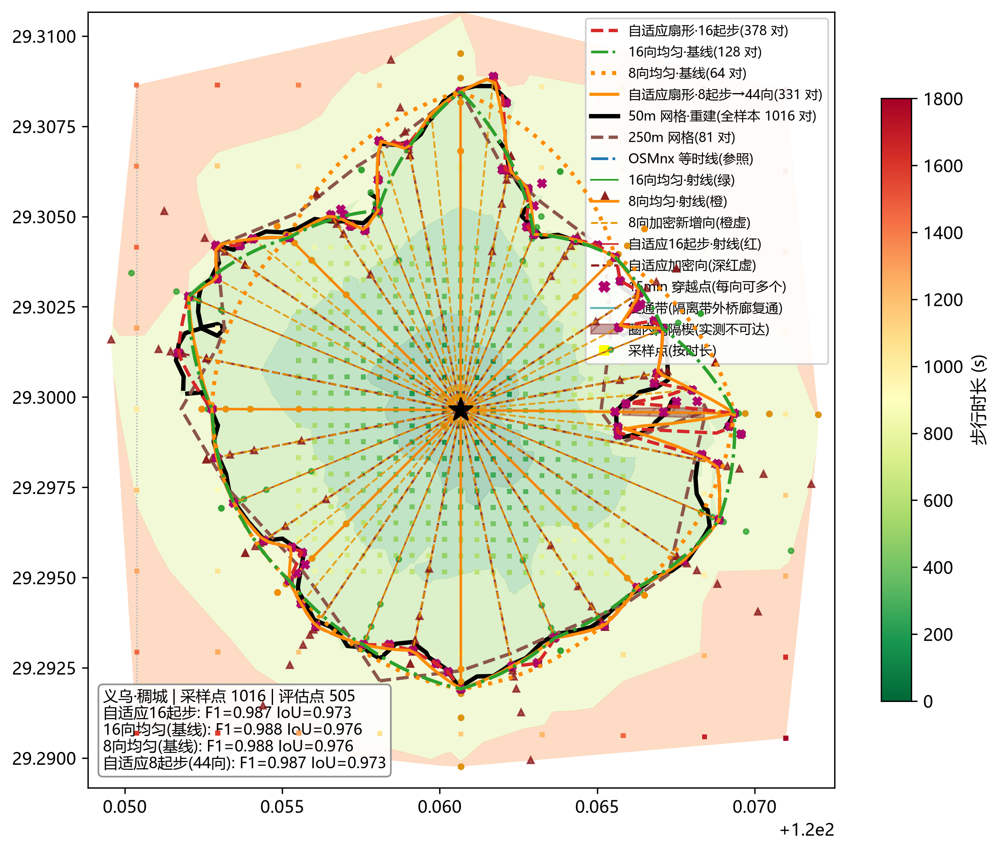

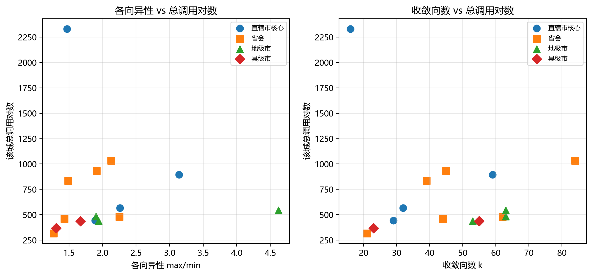

**反直觉结论**:难度主变量是**地形/水系,不是城市规模**——
小城桂林一条漓江把各向异性顶到 4.62(超过山城重庆 3.14);
平原县级市昆山反而最圆最省(k=23、未触发复杂信号、IoU 0.967)。

| 梯度 | 城 | 特征 |
|---|---|---|
| 直辖市核心 | 北京A/B、上海、重庆 | 胡同/超级街区/江|
| 省会 | 广州、成都、哈尔滨、西安、长沙、武汉 | 城墙/江/铁路|
| 地级市 | 洛阳、遵义、桂林 | 古城/江|
| 县级市 | 昆山、义乌 | 平原/商圈|
| 同城异区 | 回龙观/张江/珠江新城/玉林 | 见下 |
| 演示城 | 南昌(从零现场) | 见第七幕第五卡|

### 同城异区对照(2026-09-01 新增)

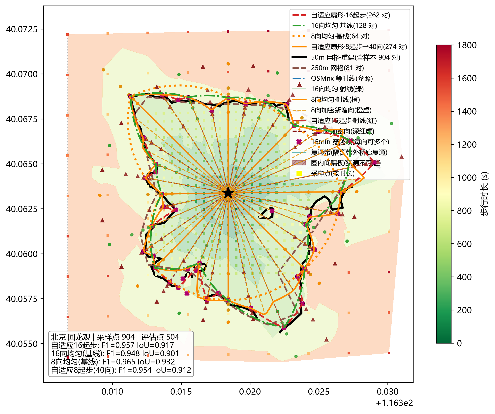
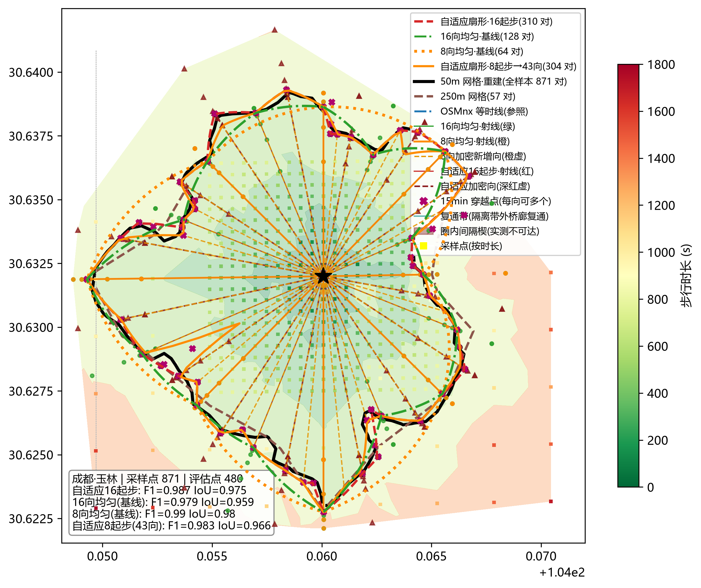

**题眼**:同在北京/成都,回龙观 57.3 vs 玉林 95.2——**街区类型差异 >> 城市差异**;
回龙观多边形 IoU 0.826 → 场口径 0.955(+12.9pt),佐证居住区必须输出重建场。
(后续社区一律不下载路网——用户指示;新图无底图,其余图层同风格。)
> 〔待补槽位:新城市按行追加〕

---

## 第七幕 · 优化之路:六张问题卡

> **问题卡模板**(复制填空,新问题随时加):
> ① 现象(配图)/ ② 数据诊断 / ③ 修复规则 / ④ 效果(前后图或数字)/ ⑤ 一句话教训

### 卡 1 · 成都"画错的黑线"

- **现象**:50m 网格线时有时无,有时一团乱
- **诊断**:±500m 实测框在多数城市整体位于边界以内,框内根本没有 15min 交点可画
- **修复**:黑线改为**全样本 Delaunay 重建到 50m 格 + 弦约束**(超该向边界+80m 不采信)
- **效果**:黑线稳定闭合;还顺带照出成都西南真凹口(锦江湾,427m 处实测 924s)
- **教训**:**方法线必须来自覆盖全域的重建,不能来自碰运气的局部实测框**

### 卡 2 · 义乌"一根针"(用户红圈)

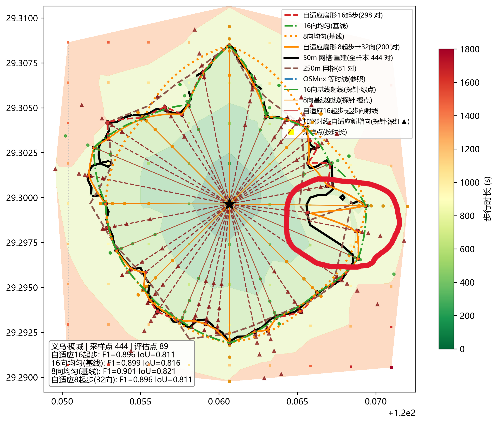

- **现象**:东侧一根 350m 深的孤立尖刺(95.6°=486m vs 邻 842/805m)
- **诊断**:三条射线的距离阶梯独立证实是**真实窄槽**(铁路,~80m 宽);
  算法错在只插一根射线,把真凹口渲染成了针
- **修复**:**弦差再平衡**——|Δr|>150m 的弦无条件中点插向,十五城 +3~20 向/城
- **效果**:孤针 → 有四向支撑、有宽度的凹槽
- **教训**:**渲染病态 = 欠采样证据**,先查数据再怪画笔

### 卡 3 · 遵义"一根射线上多个 15 分钟点"(用户蓝圈)

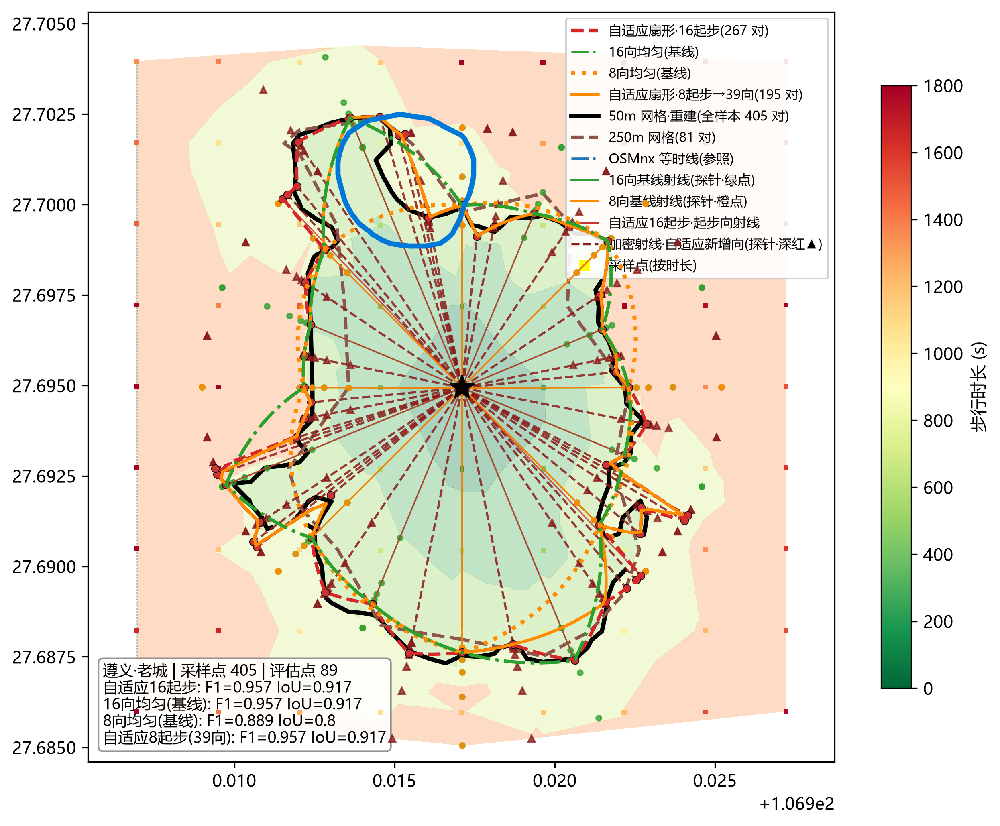

- **现象**:射线穿过湘江:可达→超时→**又可达**(对岸)→再超时,多段穿越
- **诊断**:单半径表示法天然画不出"垂直凹腔";严格扫描(需超时带夹层)十五城共 6 条
- **修复**:**复通带表示法** pocket={r, 隔离带 g0-g1, 复通至 outer} + 地图青绿楔形层
- **效果**:十五城平均 IoU 0.930 → **0.933**(全历史最优);地图新增玫红 X"每向全部穿越点"
- **教训**:**边界是一维线,可达性是二维域**——凹腔/桥廊需要第二表示层

### 卡 4 · 重庆"两端一起错"(ρ 的唯一战场)

- **现象**:163.1° 两侧 Δr 仅 33m,再平衡不触发;mid 探针通过——但这一带整体偏了
- **诊断**:**相关性误差**:两条射线共用同一过河点,半径一起高估
- **修复**:ρ 端到端探针暴露;**ρ 从"插向器"重新定位为"校准器+预测器"**
  (砍无条件插向,保留 24 探针/城抽样 + 收紧触发:ρ>max(τ,2.2) 且 Δr<150 且 arc>22.5°)
- **教训**:**规则重叠时按性价比分工**,不是全都要

### 卡 5 · 南昌"小角度窄刺"(从零演示现场)

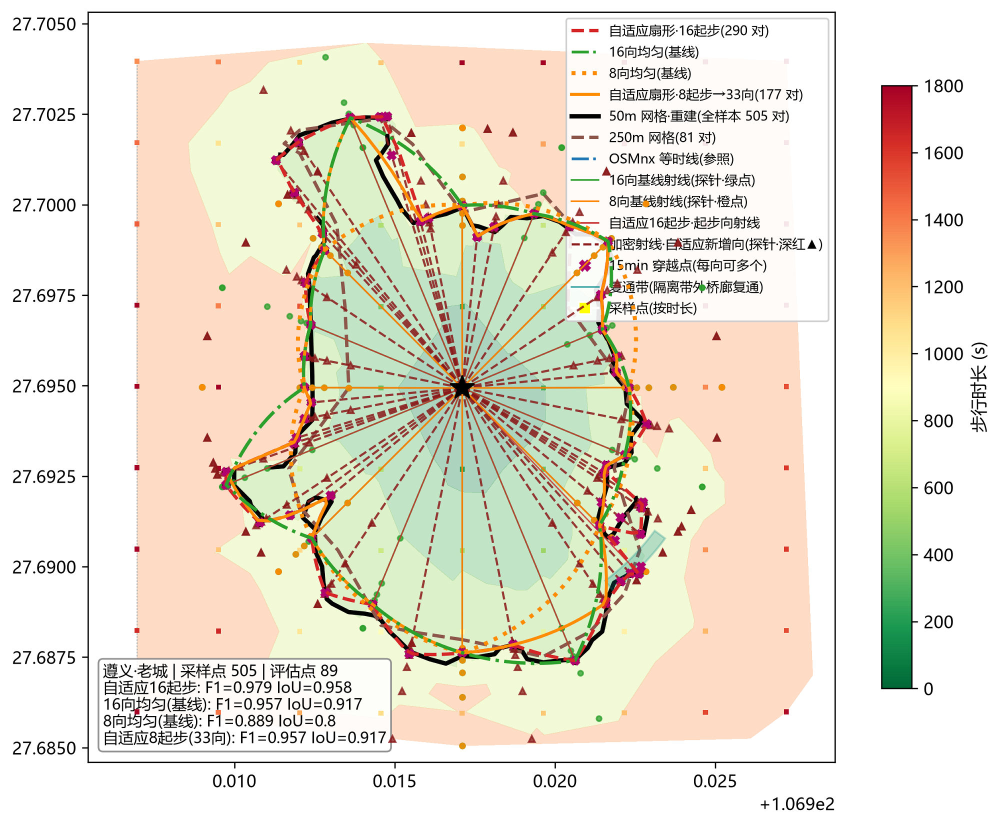

- **现象**:径向夹角小的边界(348.75°=379m 窄刺)径向探针测不出"弦横向"对错
- **诊断**:mid 探针沿半径走;小夹角弦的错误在**边的方向**上
- **修复**:**S5b 边级验证**——arc≤22.5° 且(Δr>80 或 arc≤11.25°)的弦,
  在**边中点(两端点线性中点)**实测:超时=凹、1.06 外扩可达=凸 → 插向
- **效果**:k 23→65,**F1 0.966→0.982、IoU 0.933→0.966(FP 清零)**;~80 对/城

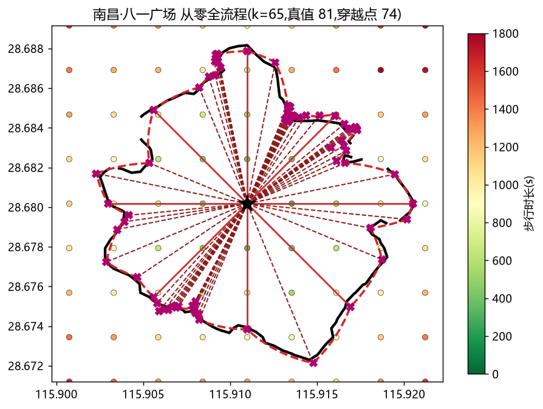

- **教训**:**验证对象要跟着表示法走**——画的是弦,就该测弦

### 卡 6 · 教育"选址乌龙"(OSM 说 100%,百度说 8.7%)

- **现象**:MCLP 教育选址 OSM 口径覆盖 23/23,百度实测仅 2/23
- **诊断**:OSM 用路网长度/4.2km/h,不含过街与立体设施罚项;≥5 个候选在 OSM 并列,
  百度把它们拉开到 2~20/23
- **修复**:换址 (45.78763,126.64350) 百度 87%;流程定为 **OSM 初筛 → 百度破平 → 处方**
- **教训**:**参照仪器也有盲区,最终口径必须以产品 API 实测收口**

> 〔待补槽位:下一张问题卡〕

---

## 第八幕 · 事故复盘:我们踩过的坑(工程教训)

| # | 事故 | 根因 | 修复 | 铁律 |
|---|---|---|---|---|
| 1 | 两次写入 135+132 条 800m 假半径 | CityRunner 预算按全局 EID 计数,截断后 bisect 零探针仍写盘 | 每城独立 EID + **零消耗批次整批丢弃** | **截断≠成功,必须显式暴露** |
| 2 | 复通带二分方向写反,产出 1390m 垃圾 | want_ok 分支 hi/lo 推反 | 显式两个方向函数 farthest_ok / nearest_x | 边界搜索要写两个具名方向 |
| 3 | 经纬度顺序 bug ×5 | (lat,lng)/(lng,lat) 无类型区分 | 待 LatLon 类型重构(TODO P2) | 坐标必须有类型 |
| 4 | 缓存 1ulp 失配 | geocode 全精度 vs 缓存键 6 位舍入差 1e-6 | 外部重放用缓存中的 origin | 重放必须用写入时的键 |
| 5 | 配额 302 中途耗尽 | 按对计 5000/日(实测),非按请求 | measure() 302 优雅降级:跳过新探针、不写假半径 | 预算尽头也要优雅 |
| 6 | 评估脚本自身公式错(曾冤枉 runner) | 把"评估格总数"当"圈内格数" | 精确 inter/union 重算 + 更正记录 | **指控别人前先验证自己的尺子** |
| 7 | S5b 批量版 153 条 800m 假半径(二进) | 守卫放在"写入之后"而非"写入之前" | 逐条 bisect 前后核对消耗,零探针当场弃 | 守卫必须在每次写盘前 |
| 8 | "8起步省一半"结论被推翻 | 对照基准用了超收敛成品;且 S5b 插入向混入路由参考集,低估自检把 8 向拖向密网(遵义/哈尔滨/洛阳成本爆炸) | full 参考集固定为 22.5° 生产网格;阶梯口径重测 | **结论先问基准公平不公平** |

> 〔待补槽位:新事故按行追加〕

---

## 第九幕 · 从体检到处方再到一键管线

**通俗版**:前面所有方法攒成一条流水线,给哈尔滨道外老城做了全套体检:

1. **体检**:taxonomy POI 检索 + 去重 + 场插值 → **94.1/100**
   (养老词表补全后 0→6 家,综合分 79.4→94.1)
2. **盲区**:扇区盲区 + 50m 格网盲区(养老 7/8 扇区、217 格)
3. **处方**:MCLP 选址——养老 3 站百度口径 **98.5%**;教育换址 **87%**(卡 6)
4. **一键管线** `python experiments/pipeline.py`:地址→等时圈→体检→评分→选址→报告,
   **二跑零调用断言通过**(`docs/12`)
5. **南昌从零现场**:20+ 格 notebook 真实 API 全流程,~215 对,IoU 0.966

> 〔待补槽位:第二社区体检泛化(待配额)〕

---

## 第十幕 · 成本账本与性价比

四天总账:**3,885 次请求 / 16,965 对**,全台账可审计(calls.db)。

| 档 | 内容 | 对/城 |
|---|---|---|
| 纯等时圈 | 8 起步 + 加密链收敛 | 104-212 |
| 生产全流程 | +mid/真值/指标 | **~215**(南昌 0.966 实证)|
| 实验档 | +50m框/三防线/验证 | 317-1034(均~1000)|

增强项性价比(每 100 对换 IoU):**S5b +4.1pt** ≫ R2 融合(∞,零 API)>
ρ 热弦 +0.1pt > REBAL ≈0(纯几何)。降级链 L0-L3 见 `docs/README` 一页纸 v2。

> 〔待补槽位:E11/E12 落地后的新成本档〕

---

## 附录 A · 图索引(新增图放 `experiments/results/maps/` 后在此登记)

| 图 | 用途 | 所在幕 |
|---|---|---|
| A.png | 七方法同图/图层规范 | 三 |
| multi_threshold_{harbin,kunshan,guilin}.png | 多阈值重放 | 四 |
| harbin.png | 最难城/复通带 | 五 |
| guilin.png / kunshan.png / yiwu.png | 各向异性之最/最易/最难 | 六 |
| size_difficulty.png | 规模-难度回归 | 六 |
| anno_yiwu_needle.png / anno_zunyi_band.png | 用户圈注的问题现场 | 七(卡2/卡3)|
| anno_nanchang_smallangle.png | 南昌小角度窄刺·修复前(用户蓝圈) | 七(卡5)|
| nanchang_demo.png | 南昌·修复后/从零全流程成果 | 七(卡5)|
| 其余十城 png | 城市档案 | 六 |

## 附录 B · 数字速查

十五城 IoU:多边形 0.904 / **融合+复通带 0.933**;带外真误差 10 格/15 城;
ρ 中位 1.29-1.98;QPS 安全线 16(声明 50/3s);批量 50 对/请求;
8向起步成本 104-212 对;南昌演示 215 对;总账 3885 次/16965 对。

## 附录 C · 答辩 Q&A 预案(持续补充)

- **Q 为什么不直接用 OSM 免费算?** A:OSM 是参照仪器不是产品口径:一致性 r 0.12-0.93
  (陆家嘴失真反例),教育选址 OSM 100% vs 百度 8.7%(卡 6)——初筛用它,收口必须百度。
- **Q 为什么信弦/mid 探针不信 F1?** A:哈尔滨 8 向 F1 反超成品;四城违规清零 IoU 不变——
  粗评估点看不见窄幻影,探针看得见(第五幕)。
- **Q 配额超了怎么办?** A:降级链四级,L0 重跑零调用/L1 302 优雅降级不写假半径/
  L2 直线×ρ/L3 无路网出图(第八幕 5 号事故现场验证)。
- **Q 8 向够吗?** A:够不够由证据定:弦规则加密到 k=16~87,城市难度自动定价(第六幕)。
- **〔待补 Q〕**

---

*维护人备注:本文件是活文档;实验有新进展,优先更新对应幕的〔待补槽位〕与附录。*
