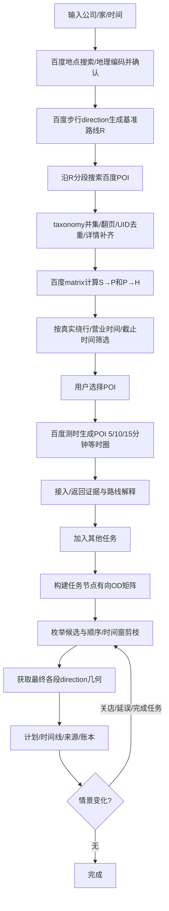

# 顺路 · 比赛版算法流程与开发契约

阅读入口：[当前产品与运行](../README.md)、[当前算法与研究证据](research/README.md)。本页保留算法和数据约定的演进，后续更新优先于对应的旧章节。

2026-10-16 模型仅处理语义和短文，见[docs/81](81-社区解读与智能路线安排.md)：社区统计通过完整性校验才解读，不修改分数；路线解析闭合类别/整数时限，原有向矩阵及规划器负责可行性和选店，不能由LLM编造路线。成功同源更新可编辑途经点及地图；临时维持旧途经点顺序的约束不固化为隐藏依赖，后续手动排序仍可用。失败恢复原状态，用户编辑/换路线后迟到回复不覆盖。只有显式操作消费模型，配置在服务端环境。

2026-10-16生产契约见[docs/79](79-新网格上线与设施社区评分.md)：生活圈及沿途活跃入口采用grid-frontier-barrier-v4圆盘100米前沿，15分钟半径1100米/376外部位置上限，逐批最多50有向OD、串行节奏及正式限流均保留。沿途固定900秒、逐中心异步补测，最多5中心1880对上限；缓存读取与状态刷新不主动查询上游。加载预览和终态实测点Delaunay/前端圆角仅描边，分析/面积/采样/评分仍使用frontier.polygons洞和多分量。社区评分是所选服务平均采样覆盖率，不排除未知类别凑满分，未覆盖位置及新增建议归属同一结果。此段覆盖旧射线判定及沿途总320对条款；旧实验API保留兼容，不宣称完整路网精确边界。

2026-10-15 [docs/56](56-固定十五分钟分析与自动时间分层.md)固定生活圈分析为900秒：自动主圈900→小圈300/600，主result保持900，分层不改变覆盖判定/采样/评分/报告阈值。圈缓存共用，逐层显示；主圈失败不改用小圈分析，旧任务不得为新中心补层。删除可变时间和分层开关，圈内算法本身不改。

2026-10-15 重建显示契约更新见[docs/54](54-截图组件落地与探针等值线.md)：响应可含reconstruction，取既有成功探针作Delaunay线性时间场直接等值线，约束为径向主边界+80m；开口不闭合、无额外算路、非50m栅格逐点复现。判定/面积/覆盖继续radiiM主多边形；逐轮、终态、分层与报告携带相同重建几何，旧结果无该字段回退。全网格/非单调/口袋识别仍未移植。

2026-10-15 用户指定分类放宽：采用broad-related-v1，名称/真实tag符合近似生活服务即计入，可跨类；每类仍一组≤10词/45字符的并集查询。类别缓存含语义版本，报告serviceMatching注明口径；实际圈内过滤、测时覆盖、未知错误防护保持。旧市场/超市、养老/活动设施互斥条款由docs/39最新更新覆盖。

2026-10-15 渐进显示契约：每轮自适应加密的中点检测与二分之前发布当前完整实测圈的独立副本，前端按状态轮询更新同源地图边界；快于轮询的阶段允许合并，不为播放动画延时。测量期间统一锁定业务跳转/选点/参数，结束或失败解锁，失败不触发设施流程重复算圈。见[docs/52](52-等时圈测量锁定与逐轮显示.md)。

2026-10-15 后续修复：正式生活圈`m3-adaptive-batched-v1`为16向起步、长弦/梯度/中间实测违规加密，25米容差、320唯一探针预算、最多2轮/48向。不是完整网格或非单调口袋重建，不继承研究IoU。预估虚线与实测分离，完整基础圈先显示再补测；缓存缺加密测值继续后台。矩阵并发按OD条数而非HTTP计数，默认3条/秒，同轮2批并行、总4槽。此条覆盖本页前次固定八向的状态说明，详见[docs/48](48-自适应生活圈与并发修复验收.md)。

2026-10-15 审查修订：地图、采样和报告统一用实际射线多边形，不做移动半径的平滑或按单圈缩放时间层；缺测/L2不参加实测覆盖。在线v4当前为预算内8向批量括界/二分，下文8.2的自适应加密/mid/pocket步骤保留为研究目标，不宣称已实现或具备历史441点/非单调全量识别精度。过期缓存不作为有效数据降级；QPS、401冷却和结构化错误按docs/47执行。

2026-10-13 圈与热力结果复用：精确坐标/坐标系、算法参数版本、时间、预算隔离完整圈缓存，时间切换/热力层共用入口，部分结果不保存。源OD peek及矩阵expiresAt汇总至等时圈响应、派生命中不续期；前端上限10分钟/50项且不得超过源到期时间，刷新回后端校验。详见docs/42。

2026-10-13 类别结果复用：以地点/时间/近似边界/采样点/服务及检索语义为键，已完成结果可复用，失败/未知不保存。前端深复制、最多50项/10分钟，受全部POI和矩阵源最早到期时间约束；响应缺expiry不保存，原API TTL及源hash保持不变。后端POI cacheHit及expiresAt、矩阵expiresAt贯通HTTP模型，索引命中不续期。详见docs/41。

2026-10-13 设施地图契约：标记只来自当前类别的已确认参评设施，按服务ID＋地点坐标/UID绑定，旧类别事件拒绝；默认图标点击只读现有元数据，显式操作才请求圈中心→设施路线，不混作采样点覆盖证据。已覆盖采样点停止绘制但测值/统计不删，JSON报告标记类型同步。详见docs/40。

2026-10-13 报告契约：`life-circle-report-v2`由当前页面证据生成，不增加API调用。所选服务单列基线/设施/有向测值；未选只在目录标not-selected，未知百分比/基线为null；与UI共用算术平均函数。模拟单独保存发起时输入和结果，重复模拟测真实基线未覆盖点，不能累计上一模拟的覆盖。图表、地图显示与真实基线分开记载，当前类别建议明确有限候选及未评估/加载状态。详见docs/39。

2026-10-13 服务语义契约：29项按选择检索，单服务同义词用$并集（≤10词/45字符）；真实名称/tag校验，地址不作服务证据，品牌缺证据未知，圈外或明确错类候选排除。市场、超市、生鲜、托育、小学、培训独立；原五类权重删除，所选项全部完成才显示算术平均覆盖率。选择变化失效结果，不自动查询。见 [docs/39](39-国家便民生活圈分类与POI检索.md)，原圈采样/有向覆盖/未知防护继续适用。

2026-10-13 最新生活圈契约：以当前时间匹配的完整实测近似多边形限定范围；圈内5×5格中心加中心去重、最多25点。查询半径由边界确定，POI先过滤圈外再取每类最多五家。七类独立覆盖、药店共享结果，五类原权重保留，菜市场/小学不重复加权；部分圈阻止分析、切换地点/时间清空旧证据。地图只标已测点。详见 [docs/38](38-生活圈入口合并与等时圈统一.md)，下文独立1km与九点契约冻结作历史记录，原缺测防护及有向OR提前结束继续适用。

2026-10-13 区域盲区契约：独立1km使用36格初始划分及整格保守距离界，边界细分到62.5米，未完整检索不得证明缺失。2.2km检索包含1.5×1.5km研究范围的外围服务设施，仍受5页/100条上限。九点步行不生成区域填色。覆盖接口必要边缺测/失败须422，明确no_route才不可达，已有可达证据仍OR提前结束；模拟增益同样校验。见 [docs/37](37-盲区判定范围与自适应区域检查.md)。

2026-10-13 分类证据隔离：每类保存自己的 coverage/times/facilities/candidates；当前类别覆盖与同类最多八个额外候选供建议计算，基线全覆盖提前结束，仅对本类未覆盖格测量。跨类有向测值不可用于证明当前类别覆盖，模拟新增不得写回真实分数。首次选择最低覆盖的已完成类别；未知类别不生成完整综合分或雷达面。步行格与独立 1km 半径格切换展示，规则不混用。见 [docs/36](36-分类覆盖联动与赛题可视化.md)。

2026-10-13 展示契约：来源枚举、规划/重排输入输出、时间与缓存语义不变；正常页面不展示内部原因码、任务 ID 或失败组合计数，未知原因给予可操作提示。虚拟执行明确标为“行程预演”，其错误独立显示；有限候选与近似范围仍保留可见边界。见 [docs/35](35-产品文案与信息层级整改.md)。

2026-10-13 用户途经顺序契约：`visitOrder` 按当前任务 ID 构成前驱链，与原硬依赖合并，规划、执行完成检查、事件重排共用；不覆盖营业窗或忽略顺序以取得更低成本。坐标/类别变化即时递增请求代数，地图覆盖物按渲染批次及地点身份绑定。原生底图 UID 经服务端详情取得入口坐标后调用已有步行接口；缓存 TTL/来源规则不变。见 [docs/34](34-地图POI刷新与途经点顺序.md)。

2026-10-13 选点地址契约：`POST /api/locations/resolve` 接收具名坐标，统一转换 BD09 后调用真实逆地理编码，沿用缓存/账本/TTL；地址解析不得用附近地物坐标替换选点。无地址明确报错，可保留用户填写名称的原始位置。前端过时搜索/解析响应丢弃，确认才向业务表单回填，选中心不自动测圈。详见 [docs/33](33-地点搜索与地图选点整改.md)。

2026-10-12 五类候选检索范围：每个关键词只查第一页，合并去重返回候选后按距离取最多五家参评。覆盖分只描述所选候选集的九格有向测值，不是完整设施供给或普查；检索截断须显式提示“其他设施未纳入”，未覆盖不能推断现实缺服务。截断且无候选仍未知，不填零；接口失败/任一必要路线未知仍不生成完整综合分。选址也只针对已返回的候选，未穷尽所有位置。此范围不改变独立 1km 设施缺失体检的穷尽检索/未知规则。

2026-10-12 短圈修正 `m2-ray-bisect-v4`：200m 为内端点起始探针，不是硬搜索下限。若其真实耗时超出阈值，继续向内减半，距离不大于容差时实际测量原点；只有实测可达内点与实测超时外点形成括界才二分。原点耗时不预填零，缺测保留失败，未发探针保留 skipped，向内扩展计入原有 maxPairs 硬预算。新版算法键失效旧派生圈，仍复用未过期原始有向 OD。

2026-10-12 覆盖省调用契约：每类候选、九格和权重不变；一个有向实测 `T(grid,facility)<=threshold` 即证明该格该类覆盖，停止其它设施测量。未覆盖格须测完所有参评候选；未测/错误不推断不可达，若另一个候选已证明可达则覆盖仍确定。baseline 保存实际测量的边，覆盖布尔值与完整矩阵 oracle 一致。新增设施和贪心建议仅对未覆盖格求增益，已覆盖格不再发矩阵请求。见 [docs/31](31-节省额度验收与最终差额.md)。

2026-10-07 新增 `POST /api/route-bands`：实际路线最多五中心，5/10/15/20 分钟独立八向单程近似圈，仅完整中心参与保孔洞的几何并集。精确有向 OD 索引复用产品缓存；源响应 hash/过期/全部参数控制派生失效。默认只读零外呼，显式单中心补测，最多 64 求值/中心、默认 320 求值/轮；重试实际计费另计。范围用于近似展示/候选过滤，门店可行性仍按原有向绕行/时间窗算法。详见 [docs/30](30-沿途等时带缓存与验收.md)。

2026-10-07 端点语义更新：S/H 表示任意起点/终点；内部 company/home 字段仅为持久化兼容，界面不限制地点用途。反向必须交换端点并重新请求有向路线和矩阵，不复用原方向的耗时。地点预览不自动计算等时圈；算法能力在对应入口显式运行。最新 UI 验收见 [docs/28](28-沿途通勤简化版与通用路径验收.md)。

更新：2026-09-22。状态：比赛版采用纯 live API；代码已具备 live provider、缓存、账本和基础页面，仍需按本文验收未闭环功能。

本文回答后续开发最容易混淆的三个问题：现有仓库已经验证了什么；比赛应用实际采用哪套流程；每一步的数据来源、输入输出、缓存和失败语义是什么。产品范围见 [18-比赛版产品与实现方案](18-比赛版产品与实现方案.md)，研究版完整等时圈见 [17-最终算法全流程](17-最终算法全流程.md)。发生冲突时，比赛应用以本文为开发契约。

## 1. 一条总原则

百度能提供的空间事实使用百度实时API或其可追踪缓存；百度不能可靠提供的行为时间才使用模拟或用户输入。任何派生结论必须能追溯到二者。

| 内容 | 来源 | 失败时的行为 |
|---|---|---|
| 地址、坐标、POI、导航点、分类 | 百度API/API缓存 | 显示未知或要求重选，不编造 |
| 营业时间、经营状态 | 百度有返回则采用 | 缺失为unknown；演示补值逐字段标模拟 |
| 路线、距离、步行耗时 | 百度direction/matrix或同请求缓存 | 不可达、API失败和配额失败分别表示 |
| POI等时圈 | 百度步行矩阵测值 + 本项目重建算法 | 可返回partial，不写假半径 |
| 排队、购物、取件、办事时间 | 用户输入或固定seed模拟 | 可编辑，标记synthetic-assumption |
| 临时关店、延误 | 比赛情景事件 | 仅影响派生计划，标记为模拟 |

核心来源枚举：`live-api`、`api-cache`、`synthetic-assumption`、`user-input`、`derived`。`derived`必须带父数据引用或hash。

## 2. 当前代码事实与实现目标

现有研究代码不是比赛应用可以直接调用的通用引擎：

| 项目 | 当前代码事实 | 比赛应用目标 |
|---|---|---|
| 端到端入口 | `experiments/pipeline.py`偏哈尔滨，POI和MCLP硬编码 | 任意已确认公司/家/POI，统一服务接口 |
| 初始等时圈 | pipeline为16向、固定[200,1400]m、tol15 | 产品档8向起步、tol50、可配置自适应括界 |
| 加密规则 | pipeline使用旧弦违规/角度规则 | 采用研究v7中有在线证据支持的触发器 |
| 最终研究规格 | docs/17：8向、v7触发器、mid、复通带、三层表示 | 按API预算分层；没有密集场时不伪造场线触发 |
| POI检索 | 每关键词最多3页、中心圆形检索 | 沿路线分段、多关键词、完整翻页、UID去重、详情补齐 |
| 路径数据 | 实验缓存多为单中心→目标 | 新任务所需任意OD通过百度矩阵/live缓存取得 |
| 模式 | 历史脚本 live 或实验缓存 | 产品统一 live API 契约，真实响应缓存仅用于去重，字段来源可见 |

因此后续开发不能把 `experiments/pipeline.py` 移进后端后宣称完成。可以复用 `core/baidu_client.py`、坐标转换、缓存思想、实验算法函数，但必须拆除城市硬编码并实现本文契约。

## 3. 总流程



每个阶段只消费前一阶段明确产物。地图图层和动画是结果视图，不能反向成为计算依据。

## 4. A0：live API 提供器

### 输入与输出

- `LiveApiProvider`：通过 FastAPI 调用百度；响应落产品缓存和产品调用账本。
- 服务端 `api-cache` 只保存真实百度响应，不是独立数据模式；缓存缺失或过期时走真实 API，失败时明确返回错误。
- 输出领域对象：`Place`、`ApiRoute`、`TravelMatrix`、`IsochroneResult`。

### 不变量

1. 浏览器不持有百度Server AK/SK。
2. 请求hash包含接口版本、坐标系及所有影响结果的参数，不包含密钥。
3. API缓存保存原始响应 hash、抓取时间和接口版本；模拟假设单独存放。
4. 同一结果内不能把真实 API、缓存响应和模拟假设静默混为同一来源；允许派生时必须逐字段保留来源并在 UI 提示。
5. 本次 live 调用、cache hit、历史实验调用分别计数。

## 5. A1：位置确认与基准通勤路线

### 5.1 位置确认

输入自由文本公司/家，先用地点输入提示或地点检索获得候选；用户确认后保存：

```text
PlaceRef = {
  uid?, name, address,
  coord: {lng, lat, crs: BD09},
  naviCoord?, source, fetchedAt
}
```

有 `navi_location` 时路线优先使用导航引导点；没有则使用POI中心。仅靠地理编码得到的地址没有UID，不能伪造UID。

### 5.2 基准路线

调用百度步行direction：`route(S,H)`，得到：

- `B = durationSeconds`
- `distanceM`
- 逐步路线几何和step时长
- 展平后的polyline `R`
- 由step边界组成的有序路线样本 `r0...rn`
- 到每个样本的前缀耗时 `prefixSeconds[i]`

路线样本优先采用step端点；长step再按距离插值采样，但插值点的前缀时间必须标为derived。基准路线响应变化时，所有沿途POI和派生绕行结果失效。

## 6. A2：沿路线召回POI

### 6.1 召回，不做最终判断

1. 沿R按配置间距选择搜索中心，搜索圆半径应覆盖相邻中心之间的间隙。
2. 每一类别使用taxonomy并集，例如药店包含“药店/药房/大药房/医药”等。
3. 每个中心×关键词持续翻页，停止条件依次为：空页、返回数小于page_size、已到API可见total/上限、预算触顶。
4. 合并所有结果，按UID去重；无UID条目用“名称+坐标+地址”临时键并标低置信度。
5. 用POI点到路线polyline的几何距离做走廊过滤。这个距离只负责召回和排序预筛，不用于计算绕行。
6. 对预筛后的有限候选批量取detail，补齐营业时间、导航点、状态和分类。

默认参数在实现配置中维护，不写死在组件。首个live场景需要记录窗口数、关键词数、页数、原始条数、UID去重后条数和截断原因。

### 6.2 数据完整性

百度开放API不是现实POI全量。结果对象必须附：

```text
retrieval = {
  queryTerms, windows, pages,
  rawCount, uniqueCount,
  truncated, truncationReason,
  source: live-api | api-cache
}
```

界面使用“百度可检索到N家”，不能使用“附近共有N家”。模拟数据不能用来填补百度漏掉的现实商户。

## 7. A3：沿途绕行和可行性

### 7.1 自由重规划模式

对每个候选POI p，批量测量有方向耗时：

```text
B        = T(S,H)
viaP     = T(S,p) + T(p,H)
detour   = viaP - B
finish   = departure + T(S,p) + wait(p) + service(p) + T(p,H)
slack    = deadline - finish
```

- `T`来自百度matrix或相同请求缓存。
- `wait/service`来自用户输入、模拟假设或由营业窗口计算，必须保留来源。
- `detour`允许出现负值，因为经POI的替代路线可能比基准路线更快；不得静默截为0。异常负值进入direction复核或显示为替代路线节省。
- 候选可行需满足路径均存在、额外路程预算、已知营业窗口和全局deadline。

### 7.2 保留基准路线模式

当用户希望办完事后回到原通勤走廊，对路线样本枚举 `i <= j`：

```text
cost(i,j,p) = prefix[i]
            + T(r_i,p)
            + wait/service
            + T(p,r_j)
            + (B - prefix[j])
```

矩阵批量测 `r_i→p` 和 `p→r_j`。接入与返回可以不同点，但不能 `j<i`，以免把逆序折返误判为顺路。选择总完成时间最小且满足时间窗的组合，并保存次优合法组合供营业时间冲突时比较。

P0多任务采用自由整体规划。用户从保留路线模式加入多个任务时，UI必须提示将整体重排；多站固定走廊约束留到独立实现和测试后开放。

### 7.3 候选排序

建议默认排序键：

1. 可行状态
2. `finish`或`detour`
3. 营业时间可信度
4. 路径完整性

直线距离、评分和名称匹配只能作为破平或筛选项。

## 8. A4：POI等时圈

### 8.1 展示和规划含义

- 默认展示从POI出发的 `I_out(p,τ)={x:T(p,x)<=τ}`。
- 路线上哪些点能到POI属于 `I_in(p,τ)={x:T(x,p)<=τ}`，用路线样本→POI矩阵计算接入证据；不能把出发圈当成进入圈。
- 等时圈用于解释POI服务范围和选择接入区，最终可行性仍由完整路线与时间窗决定。

### 8.2 产品在线档算法

以POI的 `navi_location`（没有则location）为origin，阈值τ默认为5/10/15分钟之一：

1. 查询测时缓存；缓存键含origin、destination、walking、接口版本和坐标系。
2. 8个均匀方位起步。每向先寻找一个可达内点和超时外点；研究默认区间为[200,1400]m，产品实现允许按配置向内/向外扩展并设最大半径。
3. 仅在已成功形成内外括界时二分，边界容差默认50m。测量失败不写当前区间中点。
4. 按相邻边检查在线可用触发器：
   - 弦内存在已测超时点且深入当前多边形至少40m；
   - 弦长超过200m；
   - 相邻半径梯度 `|Δr|/arc > 12m/°`；
   - 若缓存中确有足够时间场，再使用场线偏差>60m；没有场就把该信号记为unavailable。
5. 触发后在角中点插入方向，tol25细化；最多轮数、最大方向数和maxPairs均由预算守卫控制。
6. 对最终弦在 `0.97*r_at(mid)` 做mid探针；超时说明外凸幻影，插向重测。预算允许时迭代到违规清零。
7. 读取同射线已有距离—时间阶梯，识别 `可达→超时→再可达` 的复通带和圈内间隔。没有阶梯证据时不生成pocket。
8. 输出主射线多边形、测量证据和pocket/interior_gap。只有样本密度满足插值要求时才输出Delaunay重建场，并带quality标记。

### 8.3 多阈值

所有探针保存实际duration，因此5/10/15分钟可以共享测值；但不能把15分钟半径按比例缩放成5/10分钟。每个阈值都要基于已有测值重新括界/补测和提取边界，新增调用计入同一任务账本。

### 8.4 结果状态

```text
IsochroneStatus = complete | partial | degraded | failed
```

- `complete`：括界和必需守卫满足。
- `partial`：有真实边界片段，但预算不足或局部测量缺失。
- `degraded`：仅使用旧API缓存/较粗容差，必须说明降级项。
- `failed`：无法形成可信边界；不返回闭合假多边形。

研究文档中的L2直线×绕行系数只能作为显式估算图层，不得冒充百度测时等时圈。

## 9. A5：多任务时间窗规划

### 9.1 输入

- 起点S、终点H、出发时间、最晚完成时间。
- 2—5个任务；每个任务为固定POI或最多3个百度候选POI。
- 每个任务的required、precedence、服务时长、可选任务窗口。
- POI营业窗口：API已知、用户确认、模拟假设或unknown。

### 9.2 OD构建

收集 `{S,H,所有候选POI}`，通过百度matrix分批获取所有规划可能用到的有方向OD。批量大小作为适配器配置，遵守接口实测上限。OD项必须携带requestHash/source/status；不能用直线距离补空项。

### 9.3 搜索

最多5个任务、每任务3候选时，直接枚举候选选择和满足precedence的任务排列，并尽早剪枝：

```text
for candidate_assignment in assignments:
  for order in precedence_valid_permutations:
    now = departure
    at = S
    feasible = true
    for task in order:
      if T(at, task.poi) missing: reject NO_ROUTE
      now += T(at, task.poi)
      if known_opening and now < opens: now = opens
      if known_opening and now + service > closes: reject CLOSED
      now += service
      at = task.poi
    if T(at,H) missing: reject NO_RETURN_ROUTE
    now += T(at,H)
    if now > deadline: reject DEADLINE
    else retain alternative
```

unknown营业时间默认不作为硬性开放证据。比赛场景可由用户确认“继续规划”或加载明确标注的模拟时段；结果必须显示不确定性。

### 9.4 目标函数

- 最快完成：最小 `finishAt`。
- 最少步行：最小API walking distance，再以finishAt破平。
- 最少绕行：最小 `totalTravelSeconds - B`，只适用于同一起终点。

相同stop序列和指标的方案去重，不强行展示三张卡。选中最终方案后，逐段调用direction获得地图几何；矩阵值用于搜索，direction值用于最终展示，若二者偏差超过配置阈值要记录并重新校验deadline。

## 10. A6：执行与重排

执行状态保存当前节点、虚拟时间、已完成/跳过任务、剩余任务和事件版本。

- 完成任务：锁定实际完成时间，不再参与枚举。
- 延迟：增加当前时刻或某服务时长，重排剩余任务。
- 模拟关店：将目标POI在情景层设为不可选，不改写百度POI原始状态。
- 模拟路线延误：只给相关OD增加有来源的情景修正；不声称百度实时路况变化。
- 网络恢复：可以刷新live数据，但不得改写已完成历史。

重排输出before/after：被替换POI、顺序变化、预计到家变化、余量变化和失败原因。

## 11. A7：时间空档

给定start、return、时间预算W和任务服务时间，对候选p判断：

```text
T(start,p) + wait(p) + service(p) + T(p,return) <= W
```

两段T均来自百度且有方向。营业时间已知时校验；未知时保留警告。列表先用矩阵精确判断，再用已测候选/时间场绘制解释图，不能先画单程圆再把圆内POI全部判为可完成。

## 12. A8：社区体检

比赛应用保留原赛题能力，但按两种口径分别计算：

1. 中心等时圈：中心→空间点，使用A4算法。
2. 居民采样格覆盖：每个格点→每类百度可检索设施，使用步行矩阵，判断最短时间是否≤阈值。

POI通过taxonomy、分区检索、分页和UID去重获得。因百度API不是全量，报告使用“当前百度可检索数据下的采样格覆盖率”。无人口数据不称居民人数。

新增服务点是情景假设；既有POI和基础路线来自API。before/after保持同一采样格、阈值、权重和原设施集，只增加假设点并重新计算相关OD。

## 13. 缓存、账本和预算

### 13.1 两层缓存

- API缓存：规范化请求hash→原始响应/解析结果。只有TTL/手动刷新控制失效，模拟事件不能改写它。
- 派生缓存：输入响应hash+算法版本+阈值+假设/事件版本→走廊候选、圈、计划。任一依赖变化即失效。

TTL由接口类别配置并在实现时记录依据，不在文档里假定百度数据永久有效。缓存过期后重新请求真实 API。

### 13.2 账本

每次任务至少记录：traceId、stage、接口、requestHash、cacheHit、status、requests、pairs、latencyMs、budgetRemaining。前端只显示汇总，详细账本可展开。

### 13.3 预算顺序

1. 缓存优先。
2. POI先召回、矩阵筛选，只有用户选中的少量POI计算等时圈。
3. 等时圈批量测量探针，maxPairs触顶返回partial。
4. 401并发限制退避；302 日配额停止新调用，只能使用仍有效的真实响应缓存，否则明确返回配额错误，不循环重试。
5. 任何预算停止都不生成假数据。

## 14. 服务接口边界

建议接口，名称实现时可以调整但语义保持：

| 接口 | 用途 |
|---|---|
| `GET /api/locations/search?q=` | 公司/家候选 |
| `POST /api/routes/walking` | 基准或最终单段路线 |
| `POST /api/pois/corridor` | 路线分段POI召回、详情与检索元数据 |
| `POST /api/travel-matrix` | 有方向OD，服务端分批 |
| `POST /api/isochrones` | 创建测时圈任务，返回taskId |
| `GET /api/tasks/{id}` / events | 阶段、调用对数、partial/result |
| `POST /api/plans` | 结构化OD+任务→方案；服务端或共享领域模块执行 |
| `GET /api/ledger/{traceId}` | 本次调用与缓存汇总 |

响应统一包含 `traceId`、`mode=live`、`provenance`、`warnings`。API业务失败使用结构化错误码：`NO_RESULT`、`NO_ROUTE`、`UNKNOWN_HOURS`、`QUOTA_EXCEEDED`、`RATE_LIMITED`、`UPSTREAM_ERROR`、`PARTIAL_ISOCHRONE`。

## 15. 开发与验收顺序

1. 用脱敏的构造响应与联网实测响应完成适配器契约测试；不建立 replay 运行模式。
2. 打通地址→基准路线→走廊POI→绕行矩阵，不做UI动画。
3. 单独实现POI等时圈任务和预算/partial语义。
4. 用小型合成OD验证规划器，再接真实百度OD缓存。
5. 完成沿途选择、时间线和字段来源UI。
6. 加执行事件、时间空档和社区体检。
7. 用真实 API 场景做端到端验收；重复请求验证缓存命中、账本和来源，不使用人工 fixtures 代替百度空间事实。

最低验收用例：

- 百度POI直线近但真实绕行大，被正确降序或排除。
- `T(A,B) != T(B,A)`时方向没有交换。
- API营业时间为空时显示unknown，不默认24小时。
- 等时圈某方向测量失败时不出现800m等占位半径。
- 5/10/15分钟圈由测值分别提取，不按比例缩放。
- 两个POI单独可行、合并后因时间窗冲突时整体规划判无解。
- 模拟关店只改变情景派生结果，原始百度状态和响应hash不变。
- 在线演示完整链路；无网、AK 无效、限流、超时或无路时明确失败，不生成百度空间事实的替代数据。

## 16. 暂不作为既成能力

以下在实际代码和验收完成前只能写“计划实现”：任意城市通用管线、实时营业状态、全量POI、任意OD等时场、多站保留通勤路线、真实道路封闭重规划、实时GPS、排队预测。后续文档和答辩材料不得提前使用完成时态。
